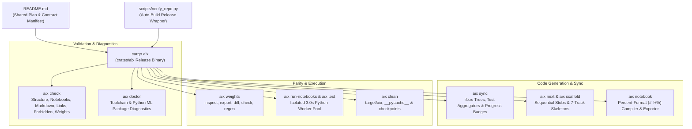

# `aix` — AI-Examples Repository Toolchain

`aix` is the native, zero-heavy-dependency Rust command-line toolchain for the [`AI-Examples`](../../README.md) repository. It unifies static validation, automated cross-track synchronization, sequential topic scaffolding, process-isolated notebook execution, and bit-exact `.safetensors` verification into a sub-second developer CLI.

---

## 1. Architectural Overview & Design Philosophy

The `AI-Examples` curriculum spans 263 deep learning and mathematical topics across 7 synchronized tracks. To eliminate the overhead of dozens of ad-hoc Python generator scripts and fragile multi-track glue, `aix` establishes three core architectural pillars:

1. **[README.md](../../README.md) as Single Source of Truth:**
   All 263 curriculum topics, completion marks (`[x]`, `[~]`, `[ ]`), category progress metrics, and strict Track 1–5 contract rules are parsed directly from machine-readable HTML comment markers in the root planning document:
   - `<!-- aix:curriculum:begin -->` ... `<!-- aix:curriculum:end -->`
   - `<!-- aix:contract:begin -->` ... `<!-- aix:contract:end -->`
   - `<!-- aix:progress:begin -->` ... `<!-- aix:progress:end -->`

2. **Zero Heavy ML Dependencies:**
   `aix` depends strictly on `serde` and `serde_json` (already present in the Cargo workspace lockfile). It compiles in seconds, requires no GPU/CUDA runtime or heavy Python ML libraries, and completes full-repository static validation across all 7 tracks in **< 0.20 seconds**.

3. **Thin Production Wrapper Contract:**
   [`scripts/verify_repo.py`](../../scripts/verify_repo.py) serves as an auto-building, mtime-checked wrapper. When developers or git hooks invoke `verify_repo.py`, it automatically builds `target/release/aix` on demand and transparently forwards all arguments and environment variables (`AIX_PYTHON`).



---

## 2. Quickstart & Invocation Modes

You can run `aix` in any of three equivalent ways:

### A. Via Cargo Workspace Alias (Recommended)
Defined in [`.cargo/config.toml`](../../.cargo/config.toml):
```bash
cargo aix <command> [options]
```

### B. Via Thin Python Wrapper
Ensures the release binary is up to date before forwarding:
```bash
python scripts/verify_repo.py <command> [options]
```

### C. Direct Release Binary
For maximum speed in CI or local scripts:
```bash
./target/release/aix <command> [options]        # Linux / macOS
.\target\release\aix.exe <command> [options]    # Windows
```

---

## 3. Subcommand Reference

### 1. `check` — Static Repository & Contract Validator
Runs parallel static validation across all 7 tracks in `< 0.2s`.

```bash
cargo aix check [options]
```

| Option | Shorthand | Description | Default |
| :--- | :---: | :--- | :--- |
| `--only <checks>` | | Comma-separated subset: `structure,notebooks,markdown,links,forbidden,weights` | All 6 checks |
| `--path <P>` | `-p` | Limit checks to files matching this path prefix (repeatable) | Entire repo |
| `--topic <T>` | `-t` | Limit checks to track files of a single curriculum topic | All topics |
| `--semantics` | `-s` | Enforce notebook Cell 1–8 semantic rules from `<!-- aix:contract:begin -->` | Off |
| `--fix` | `-f` | Auto-repair broken Markdown links in `.md` and `.ipynb` files | Off |
| `--format <fmt>` | | Output format: `human` (default), `json`, or `github` (workflow annotations) | `human` |
| `--max <N>` | | Maximum diagnostics to display per check section | `25` |
| `--quiet` | `-q` | Suppress passing check sections; only display warnings and failures | Off |

#### Checks Executed
- **`structure`**: Verifies 1-to-1 track parity against the 263-topic curriculum, detects checklist status drift, verifies generated module tree freshness, and enforces `scripts/` directory hygiene.
- **`notebooks`**: Validates 8-cell layout (`markdown`, `markdown`, `code`, `code`, `code`, `code`, `code`, `markdown`), empty outputs, stripped execution counts, and line limits.
- **`markdown`**: Enforces all 8 required architectural sections when `"enforce": true` in the contract.
- **`links`**: Extracts and validates all relative links across Markdown files and notebook cells. Detects case mismatches (preventing Linux CI failures) and auto-repairs path depth errors.
- **`forbidden`**: Scans all 6 code tracks (`notebooks/`, `pytorch2/`, `jax/`, `candle/`, `kernels/`, `core/`) for unmocked network calls (`requests`, `urllib`, `curl`, `socket`, `httpx`).
- **`weights`**: Validates SafeTensors binary headers and verifies required tensor groups (`test_input`, `weight`, `bias`, `test_output`).

---

### 2. `sync` — Automated Crate & Progress Synchronizer
Synchronizes derived Rust module trees, test runners, curriculum checklist markers, and progress badges from disk state.

```bash
cargo aix sync [--check]
```

- **`--check`**: Fails with exit code 1 if any generated file is stale. Used in CI.
- **Updated Targets:**
  - `crates/ai-candle/src/lib.rs` (Rust Candle topic module tree inside `<aix:generated>`)
  - `crates/ai-kernel/src/lib.rs` (Rust WGPU/CPU kernel module tree inside `<aix:generated>`)
  - `crates/ai-candle/tests/<cat>.rs` (Integration test aggregators)
  - `README.md` (Curriculum `[x]`/`[~]`/`[ ]` checklist marks and `<!-- aix:progress:begin -->` table)
  - `README.md` & `INDEX_BY_GOAL.md` (Top-of-file `Progress-XX/263` shields badges)

---

### 3. `status` — Curriculum Progress Dashboard
Displays a category-by-category breakdown of completed (`done`), in-progress (`wip`), and unstarted (`planned`) topics against the 263-topic target.

```bash
cargo aix status [--wip] [--category <cat>] [--format <fmt>]
```

- **`--wip`**: Lists every in-progress topic along with the exact track files still missing.
- **`--category <cat>`, `-c`**: Scopes the report to a specific category (e.g. `-c 05_architectures`).
- **`--format json`**: Emits machine-readable progress data for automated tools and agent monitoring.

---

### 4. `next` — Sequential Single-Active-Topic Resolver
Enforces the single-active-topic workflow by resolving the current WIP topic or the next sequential planned topic.

```bash
cargo aix next [--category <cat>] [--format <fmt>]
```

- **Behavior:**
  1. Searches for any active `[~]` WIP topic. If found, displays its title, category, missing tracks, and next steps.
  2. If no topic is WIP, displays the first `[ ]` planned topic in sequential curriculum order.
- **`--category <cat>`, `-c`**: Filters to the next topic within a specific category.
- **`--format json`**: Emits structured JSON for subagents.

---

### 5. `scaffold` — 7-Track Skeleton Generator
Generates contract-conforming stubs across all 7 tracks for any curriculum topic query.

```bash
cargo aix scaffold <topic> [--dry-run] [--force]
```

- **Generated Tracks:**
  1. `markdown/<id>.md`: Track 1 architectural blueprint with all 8 contract sections.
  2. `notebooks/<id>.ipynb`: Track 2 concept notebook with 8 pre-structured cells and depth-agnostic weights loader.
  3. `pytorch2/<id>.py`: Track 3 reference PyTorch 2 module with `linear_anchor` and `--export-golden` CLI.
  4. `jax/<id>.py`: Track 4 functional JAX/Equinox implementation.
  5. `candle/<id>.rs`: Track 5 native Rust Candle module.
  6. `kernels/<id>.rs`: Companion Track A native WGPU/CPU compute pipeline.
  7. `crates/ai-candle/tests/<cat>/test_*.rs`: Mirrored integration test runner.
- **`--dry-run`**: Previews files that would be created without writing to disk.
- **`--force`**: Overwrites existing files if explicitly requested.
- **Automatic Sync:** Automatically triggers `aix sync` upon completion to register the new Rust modules immediately.

---

### 6. `notebook` — Percent-Format Compiler, Exporter & Inspector
Allows authoring notebooks in pure Python percent-format (`# %% [markdown]` / `# %%`) and compiling them into clean, stripped 8-cell `.ipynb` files.

```bash
# Inspect a notebook's structure and contract compliance:
cargo aix notebook <topic>

# Export .ipynb to percent-format Python:
cargo aix notebook <topic> --export <source.py>

# Compile percent-format Python into .ipynb:
cargo aix notebook <topic> --from <source.py>

# Validate against 8-cell contract and semantic rules:
cargo aix notebook <topic> --check
```

---

### 7. `weights` — SafeTensors Inspector, Diff & Exporter
Pure-Rust binary header reader and numerical comparator for `.safetensors` files.

```bash
# Direct shorthand inspection:
cargo aix weights <topic_or_file>

# Detailed header inspection (metadata, dtypes, shapes, byte sizes):
cargo aix weights inspect <file.safetensors...>

# Regenerate golden weights via PyTorch 2 implementation:
cargo aix weights export <topic>

# Tensor-by-tensor diff (shape, dtype, byte identity, max abs F32 diff):
cargo aix weights diff <file_a.safetensors> <file_b.safetensors>

# Verify required tensor groups across weights:
cargo aix weights check [--topic <T>] [--path <P>]

# Batch-regenerate golden checkpoints with reproducibility checks:
cargo aix weights regen [--topic <T>] [--path <P>] [--check]
```

---

### 8. `run-notebooks` — Isolated Parallel Notebook Runner
Executes notebooks in isolated Python worker processes with hard OS-level process termination if a notebook exceeds its CPU budget.

```bash
cargo aix run-notebooks [--topic <T>] [--path <P>] [--jobs <N>] [--budget <secs>] [--grace <secs>] [--python <path>] [--verbose]
```

- **Process Isolation:** Spawns [`scripts/aix_nb_worker.py`](../../scripts/aix_nb_worker.py) per notebook with headless `Agg` backend.
- **Hard Timeout Kill:** The parent `aix` process uses `Child::kill()` to terminate runaway processes when `elapsed > budget + grace`.
- **Timing Log:** Exports all execution timings to `target/aix/notebook_timings.json`.

---

### 9. `test` — Single-Topic Inner-Loop Verifier
The fastest inner-loop command when developing a topic. Verifies all 7 tracks for `<topic>` in a single invocation:

```bash
cargo aix test --topic <topic>
```

- **Steps Executed:**
  1. Filtered `cargo test -p ai-candle --tests -- <slug>`
  2. Filtered `cargo test -p ai-kernel --tests -- <slug>`
  3. `python pytorch2/<id>.py` (verifies parity against golden weights)
  4. `python jax/<id>.py` (verifies functional parity)
  5. `cargo aix run-notebooks --topic <topic>` (verifies notebook execution within 3.0s)
  6. Scoped `cargo aix check --semantics --topic <topic>`

---

### 10. `doctor` — Environment & Toolchain Diagnostics
Audits the local development environment, compilers, and Python scientific stack:

```bash
cargo aix doctor [--python <path>]
```

- **Diagnostics Evaluated:**
  - Workspace root and curriculum consistency (263 topics).
  - Rust toolchain (`cargo --version`, rust-lld linker).
  - Workspace crates (`ai-architect-schema`, `ai-candle`, `ai-kernel`, `aix`).
  - Python interpreter detection (probing `.venv`, `venv`, and system Python).
  - Scientific package availability (`torch`, `safetensors`, `jax`, `matplotlib`, `numpy`).
  - Full repository static check health.

---

### 11. `clean` — Workspace & Cache Cleanup
Safely removes transient compilation artifacts, timing logs, Python bytecode, and Jupyter checkpoints:

```bash
cargo aix clean [--dry-run]
```

- **Targets Cleaned:**
  - `target/aix/` (timing outputs and reports)
  - `**/__pycache__/`
  - `**/.ipynb_checkpoints/`
  - `**/*.pyc`, `**/*.pyo`

---

### 12. `completions` — Shell Autocompletion
Generates native shell completion scripts for tab-completion of all subcommands and flags:

```bash
# Bash:
cargo aix completions bash > ~/.local/share/bash-completion/completions/aix

# Zsh:
cargo aix completions zsh > ~/.zfunc/_aix

# Fish:
cargo aix completions fish > ~/.config/fish/completions/aix.fish

# PowerShell:
cargo aix completions powershell >> $PROFILE
```

---

### 13. `ci` — Continuous Integration Gate
Runs the full verification pipeline enforced by GitHub Actions:

```bash
cargo aix ci [--format human|json|github] [--jobs <N>]
```

---

## 4. Developer Workflows

### The Sequential Single-Active-Topic Lifecycle

When contributing a new topic or completing an in-progress topic, always follow the sequential workflow:

1. **Find the Active Topic:**
   ```bash
   cargo aix next
   ```
2. **Scaffold Missing Tracks:**
   ```bash
   cargo aix scaffold <topic_id>
   ```
3. **Implement Track 3 (`pytorch2/<id>.py`):**
   Implement the core operator, input generators, and `export_golden()`.
4. **Export Golden Weights:**
   ```bash
   cargo aix weights export <topic_id>
   ```
5. **Implement Remaining Tracks:**
   - Author Track 1 architectural derivation in `markdown/<id>.md`.
   - Author Track 2 concept notebook in `notebooks/<id>.ipynb` (or via `aix notebook <id> --from script.py`).
   - Implement Track 4 in `jax/<id>.py`.
   - Implement Track 5 in `candle/<id>.rs`.
   - Implement Companion A in `kernels/<id>.rs`.
6. **Inner-Loop Verification:**
   ```bash
   cargo aix test --topic <topic_id>
   ```
7. **Synchronize & Gate Check:**
   ```bash
   cargo aix sync
   cargo aix check --semantics
   ```

---

## 5. Crate Architecture

The `aix` binary is structured into 8 modular Rust source files in `src/`:

```
crates/aix/
├── Cargo.toml         # Lightweight dependencies: serde + serde_json
├── README.md          # Comprehensive CLI & architectural documentation
└── src/
    ├── main.rs        # CLI argument dispatch, options parsing & command handlers
    ├── checks.rs      # Static check implementations (structure, notebooks, markdown, links, forbidden, weights)
    ├── curriculum.rs  # Machine-readable parser for README.md curriculum & contract JSON
    ├── help.rs        # Comprehensive command manuals, help texts & shell completions
    ├── repo.rs        # In-memory repository index, path arithmetic & case sensitivity detection
    ├── report.rs      # Formatter for human terminal, JSON & GitHub Actions annotations
    ├── run.rs         # Process-isolated notebook worker pool & cargo test orchestrator
    ├── scaffold.rs    # 7-track stub generator, next-topic resolver & percent notebook compiler
    └── sync.rs        # Safe splice generator for lib.rs module trees & README progress tables
```
