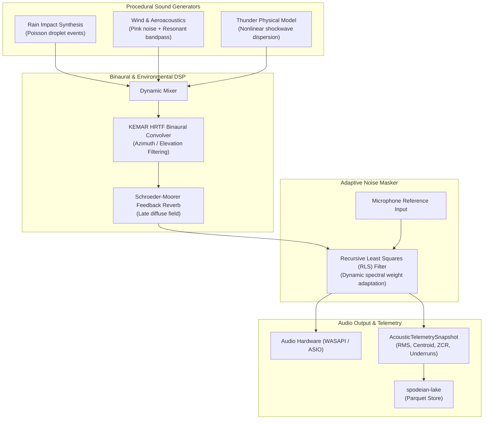
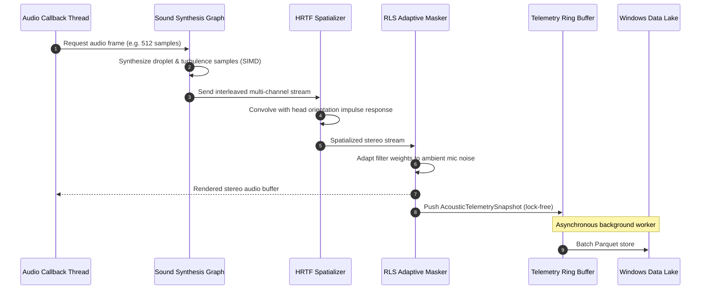

# Real-Time Audio Signal Graph & Spatial DSP Architecture

## 1. Executive Summary

This document specifies the real-time audio synthesis, adaptive acoustic masking, and spatial binaural rendering graph deployed across `RainAI` and integrated with `spodeian-core`. The engine provides sample-accurate DSP processing, SIMD vectorization, sub-millisecond adaptive filtering, and telemetry streaming into `spodeian-lake`.

---

## 2. DSP Graph Stages

### 2.1 Procedural Synthesis Engine
- **Poisson Droplet Generator**: Stochastic arrival times with droplet mass distributions mapped to damped sinusoidal impact resonances:
  $$s(t) = A e^{-\gamma t} \sin(\omega_0 t + \phi)$$
- **Wind Turbulence**: Multi-band resonant noise filtering with low-frequency oscillator (LFO) modulation for gust dynamics.
- **Physical Shockwaves**: Thunder synthesis using acoustic wave propagation delay models with high-frequency absorption ($1/f^\alpha$).

### 2.2 Spatialization & HRTF Convolution
- **Binaural Impulse Responses**: KEMAR measurements parameterized by azimuth $\theta \in [-180^\circ, 180^\circ]$ and elevation $\phi \in [-40^\circ, 90^\circ]$.
- **Time-Domain vs. Frequency-Domain**: Partitioned convolution using overlap-add (OLA) or direct time-domain FIR for zero-latency interactive head tracking.
- **Interaural Delays**: Accurate Interaural Time Difference (ITD) and Interaural Level Difference (ILD) rendering.

### 2.3 Adaptive Acoustic Masker (RLS)
- **Objective**: Mask ambient background disturbances using procedural soundscape shaping.
- **Recursive Least Squares (RLS) Algorithm**:
  $$k(n) = \frac{\lambda^{-1} P(n-1) x(n)}{1 + \lambda^{-1} x^T(n) P(n-1) x(n)}$$
  $$\xi(n) = d(n) - w^T(n-1) x(n)$$
  $$w(n) = w(n-1) + k(n) \xi(n)$$
  $$P(n) = \lambda^{-1} P(n-1) - \lambda^{-1} k(n) x^T(n) P(n-1)$$
  where $\lambda \in (0, 1]$ is the forgetting factor.

### 2.4 Diagnostic Telemetry & Telemetry Ingestion
- **Snapshot Schema**: [`AcousticTelemetrySnapshot`](file:///crates/spodeian-lake/src/schema.rs):
  - `timestamp`: i64 epoch ms
  - `frame_idx`: Audio buffer sequence index
  - `rms_db`, `peak_db`: Output power metrics
  - `spectral_centroid`: Spectral brightness indicator
  - `zero_crossing_rate`: High-frequency noise proxy
  - `active_voices`, `buffer_underruns`: Real-time engine health metrics

---

## 3. Real-Time Processing Sequence Diagram

---

## 4. Performance Guarantees
- **Zero Allocations**: Audio callback never allocates, locks, or performs filesystem I/O.
- **Lock-Free Communication**: DSP thread pushes diagnostic events via bounded crossbeam lock-free ring buffers.
- **Hardware Acceleration**: Autovectorized loops utilizing AVX2 / SSE4.1 / NEON instructions.
