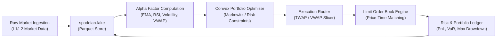

# Quantitative Financial Pipeline Architecture

## 1. Executive Summary

This document specifies the end-to-end quantitative financial analytics, factor computation, portfolio optimization, and limit order book (LOB) matching pipeline across `spodeian-core` and `Risky Business`. The architecture is designed for deterministic execution, high-throughput microsecond-scale backtesting, and automated persistence into the Parquet-backed `spodeian-lake`.



---

## 2. Pipeline Subsystems

### 2.1 Ingestion & Canonical Telemetry (`spodeian-lake`)
- **Schema**: [`FinancialObservation`](file:///crates/spodeian-lake/src/schema.rs) records tick and bar level data:
  - `timestamp`: i64 epoch seconds/milliseconds
  - `symbol`: Equity/commodity/forex asset identifier
  - `open`, `high`, `low`, `close`: IEEE 754 f64 price points
  - `volume`, `vwap`, `spread`: Microstructure liquidity metrics
- **Storage Layer**: Columnar Apache Parquet with Snappy/ZSTD compression and LRU capacity eviction.
- **Verification**: Cryptographic SHA-256 integrity verification across partition manifests.

### 2.2 Factor Computation Engine
- **Alpha Factors**:
  - Momentum: Moving Average Convergence Divergence (MACD), Relative Strength Index (RSI).
  - Microstructure: Volume Weighted Average Price (VWAP), bid-ask spread deviation, order flow imbalance (OFI).
  - Volatility: Realized volatility, Garman-Klass, Parkinson estimators.
- **Normalization**: Z-score cross-sectional ranking with winsorization at 3 sigma.

### 2.3 Convex Optimization & Risk Budgeting
- **Quadratic Programming**:
  $$\min_w \quad \frac{1}{2} w^T \Sigma w - \lambda \alpha^T w$$
  $$\text{s.t.} \quad \sum w_i = 1, \quad 0 \le w_i \le w_{\max}$$
- **Factor Covariance**: Shrinkage estimators (Ledoit-Wolf) for singular and ill-conditioned covariance matrices $\Sigma$.
- **Turnover Penalties**: $L_1$ transaction cost regularization to mitigate slippage.

### 2.4 Limit Order Book (LOB) Matching Engine
- **Data Structure**: Price-time priority double-ended queue per tick level (`BTreeMap<OrderedFloat<f64>, VecDeque<Order>>`).
- **Order Types**:
  - `LimitOrder`: Resting liquidity at discrete price ticks.
  - `MarketOrder`: Immediate execution against top-of-book.
  - `CancelOrder`: $O(1)$ lookup via order index registry.
- **Matching Pipeline**: Deterministic fill reports with volume-weighted execution price and instantaneous order book depth snapshots.

---

## 3. Detailed Sequence Diagram

```mermaid
sequenceDiagram
    autonumber
    participant Feed as Market Feed
    participant Lake as Windows Data Lake
    participant Factor as Factor Engine
    participant Opt as Convex Optimizer
    participant Risk as Risk Guard
    participant LOB as LOB Matching Engine

    Feed->>Lake: Ingest FinancialObservation batch
    Lake-->>Factor: Stream Parquet partition (load_partitions_range)
    Factor->>Factor: Compute multi-factor momentum & volatility
    Factor->>Opt: Vector of expected alpha returns
    Opt->>Risk: Target portfolio weight vector
    Risk->>Risk: Check VaR & leverage constraints
    alt Risk Check Passes
        Risk->>LOB: Submit child limit/market orders
        LOB->>LOB: Match against resting liquidity
        LOB-->>Lake: Record execution telemetry & fills
    else Risk Check Fails
        Risk-->>Opt: Constraint violation / trigger circuit breaker
    end
```

---

## 4. Stability & Concurrency Guarantees
- **Lock-Free Concurrency**: Internal states use atomic counters or lockless channels (`crossbeam-channel`) for telemetry dispatch.
- **Zero Allocations in Hot Paths**: Order queues pre-allocate buffers to prevent allocator contention.
- **Strict Verification**: Every commit is verified against clippy `-D warnings` and automated unit/integration test suites.
