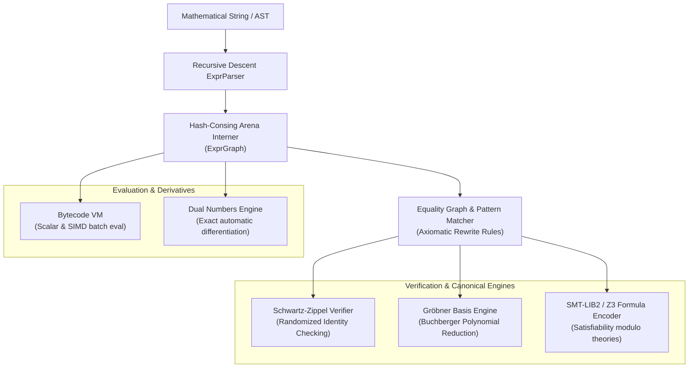
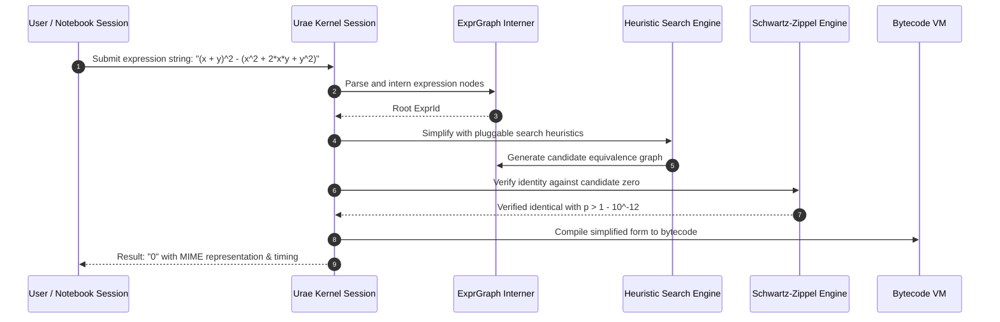

# Symbolic Arena, Expression Graph & Term Rewriting Architecture

## 1. Executive Summary

This document specifies the symbolic mathematics engine, arena allocation, hash-consing interning, term rewriting, and polynomial reduction architecture implemented across `algebra-core` and `algebra-engine`. The architecture is optimized for zero redundant node allocation, algebraic simplification, verified equality testing via Schwartz-Zippel randomization, and Gröbner basis canonical reduction.

---

## 2. Arena Representation & Hash-Consing

### 2.1 The `ExprGraph` Arena
- **Zero-Duplication Invariant**: Expressions are interned in a generational index arena (`ExprGraph`). If an identical sub-expression already exists, its existing `ExprId` is returned ($O(1)$ amortized deduplication).
- **Index Identifiers**: `ExprId(u32)` serves as a lightweight, copyable pointer, eliminating deep recursive tree traversal and heap fragmentation.
- **Node Kinds (`ExprKind`)**:
  - `Constant(f64)` / `Integer(i64)` / `Variable(String)`
  - `Binary(Op, ExprId, ExprId)`
  - `Unary(UnaryOp, ExprId)`
  - `Function(FnName, Vec<ExprId>)`
  - `Relational { op, lhs, rhs }`

### 2.2 Probabilistic Identity Testing (Schwartz-Zippel Lemma)
To verify equivalence between two high-degree polynomial expressions $P(x_1, \dots, x_n)$ and $Q(x_1, \dots, x_n)$ without combinatorial expansion:
- Compute $D(x) = P(x) - Q(x)$ of total degree $d$.
- Evaluate $D(r)$ for random choices $r \in S^n$ from a finite set $S$.
- By the Schwartz-Zippel lemma:
  $$\Pr_{r \sim S^n}[D(r) = 0 \mid D \not\equiv 0] \le \frac{d}{|S|}$$
  Evaluating over $k$ independent random iterations reduces false identity probability to $\le \left(\frac{d}{|S|}\right)^k \approx 0$.

### 2.3 Gröbner Basis Canonical Simplification
- Implements Buchberger's algorithm with normal selection strategy and polynomial division over graded reverse lexicographical (grevlex) monomial ordering.
- Allows canonical membership testing: an expression reduces to zero modulo the ideal generated by known algebraic constraints if and only if it belongs to the ideal.

### 2.4 Multi-Target Execution
- **Bytecode VM**: Converts expression graphs into linear stack-machine bytecode instructions (`LOAD_VAR`, `PUSH_CONST`, `ADD`, `MUL`, `SIN`, `COS`, `EVAL`).
- **Batch Evaluation**: Evaluates vectorized slices of variables simultaneously with cache-friendly layout.
- **Automatic Differentiation**: Forward-mode automatic differentiation via hyper-dual numbers ($f(x + \epsilon) = f(x) + \epsilon f'(x)$ where $\epsilon^2 = 0$).

---

## 3. Evaluation & Simplification Sequence Diagram

---

## 4. Verification & Testing
- **Foundational Tests**: Deduplication, cycle safety, hash-consing equivalence, and VM execution are comprehensively validated in `crates/algebra-core/tests/foundational_tests.rs`.
- **Integration Tests**: Gröbner reduction, SMT encoding, and notebook session persistence validated in `crates/algebra-engine/tests/integration_tests.rs`.
- **Zero Warnings**: Strict enforcement of `-D warnings` across the entire workspace.
